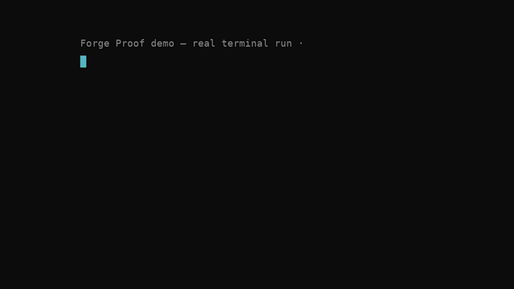

# Forge

[](https://github.com/SanjayDavis/Forge/actions/workflows/ci.yml)
[](https://pypi.org/project/forge-foundation/)
[](https://pypi.org/project/forge-foundation/)
[](docs/verification.md)
[](LICENSE)

**Project state is deterministic. Intelligence is replaceable.**

Forge is a deterministic project kernel for autonomous software
engineering. Every change to a project — by an LLM, an agent, or a
human — must be proposed, validated, and committed through the kernel.
No client ever mutates project state directly.

The planner proposes. The kernel decides.



*That is not a mock-up.* It is Proof #2 — a real CHIP-8 emulator built by
driving the kernel: 42 tasks, 259 events, 2 verification failures caught
and retried, all replayed from an append-only log. The
[raw event log](examples/chip8/events.log) is committed. Regenerate any
proof yourself with `forge proof check`.

## The one idea

Conversations and markdown plans are a bad place to keep state. They
are lossy, unreplayable, and unauditable. Forge replaces them with an
event-sourced task graph: append-only, deterministic, replayable.

| Traditional agent | Forge |
| --- | --- |
| Conversation is state | Event log is state |
| AI edits directly | AI proposes |
| Memory in prompts | Deterministic graph |
| Hard to replay | Replay built in |
| Hard to audit | Fully auditable |

See [WHY_FORGE.md](WHY_FORGE.md) for the full argument.

## Proof corpus

Claims are only worth what backs them. Every row below is a completed
project with its event log committed, its graph rendered, and a claim it
answers — check any of them yourself.

| # | Proof | Language | Tasks | Events | Verif. failures | Conforms |
|---|-------|----------|-------|--------|-----------------|----------|
| 1 | [flask-todo](examples/flask-todo/) | Python | 8 | 47 | 1 | yes |
| 2 | [chip8](examples/chip8/) | Python | 42 | 259 | 2 | yes |
| 3 | [expr-parser](examples/expr-parser/) | C++ | 17 | 96 | 0 | yes |
| 4 | [rust-cli](examples/rust-cli/) | Rust | 15 | 86 | 0 | yes |
| 5 | [swarm](examples/swarm/) | Python (4 agents) | 114 | 612 | 3 | yes |

The corpus answers specific criticisms, not "it works":

| Claim | Criticism | Backed by |
|-------|-----------|-----------|
| C1 | "Only works on toy examples" | CHIP-8, expr-parser, rust-cli |
| C2 | "Only works for web apps" | CHIP-8, rust-cli |
| C3 | "Tied to Python" | expr-parser (C++), rust-cli (Rust) |
| C4 | "Can't handle long projects" | swarm (114 tasks) |
| C5 | "Only works with one agent" | swarm (4 concurrent agents) |
| C6 | "Just a fancy todo list" | flask-todo, CHIP-8, rust-cli, swarm |
| C7 | "Can't handle structured complexity" | flask-todo, CHIP-8, swarm |


## Forge in 60 seconds

```
forge -d chip8 init
cd chip8

forge create "Chip-8 Emulator" \
  --desc "A CHIP-8 interpreter with display, input, and ROM loader" \
  -a "ROM loads and runs" --priority high
forge expand chip-8-emulator \
  -c "CPU::executes opcodes" \
  -c "Memory::4KB RAM + registers" \
  -c "Display::64x32 framebuffer" \
  -c "Input::hex keypad"

forge graph        # the task tree
forge next         # cpu — what to work on first
forge show cpu     # the context contract: task, acceptance, deps, evidence
forge progress     # done 0/5
```

What happened: a goal became a graph. The kernel computed what is
ready, handed the client a focused context package instead of the whole
project, and recorded every step in an append-only log. The planner
proposes; the kernel decides. Nothing was mutated directly.

Already have a plan? Commit it as a proposal — atomically or not at all:

```
forge -d my-project propose examples/proposal.example.json
```

## Architecture

```
                Human ─┐
                Planner │   (proposals only — never touch the graph)
                Executor├──► Proposal Layer ──► Kernel ──► events.log
                Reviewer│        (validate → append → apply)
                MCP     ─┘
                                 │
                                 ├── scheduler (ready/next/blockers, priority-ordered)
                                 ├── verifier gates (status/dependency/container)
                                 ├── context builder (the ~500-token contract package)
                                 ├── inspector (task dossier + history)
                                 └── query language (safe expression subset)
```

Above the line: intelligence. Below it: deterministic computing.

The SDK in five calls — the whole executor flow:

```python
from forge import ForgeClient

forge = ForgeClient("path/to/project")
task = forge.next()                        # next ready task
ctx  = forge.context(task["id"])           # the ~500-token contract
result = llm(ctx)                          # code, tests
forge.attach_evidence(task["id"], "hard", "unittest", detail)
forge.verify(task["id"])                   # Forge decides "done", not the LLM
```

One implementation. Many clients: Hermes, Claude Code, Codex, a human
with a terminal, an MCP server, a VS Code panel.

## Install

```bash
pip install forge-foundation forge-planner
pip install forge-mcp-base            # optional: MCP server transport
forge --help
```

Naming, to keep it unambiguous:

| What you call it | Value |
|------------------|-------|
| **Project** | Forge |
| **PyPI package** | `forge-foundation` (the names `forge`, `forge-sdk`, `forge-core`, `forge-kernel` are squatted on PyPI) |
| **Python module** | `forge` — `from forge import ForgeClient` |
| **CLI** | `forge` — `forge init`, `forge plan`, `forge next` |

`forge` is the kernel + CLI + public SDK. `forge-planner` is the
reference planner (a separate distribution) and registers the `forge
plan` command at runtime through a `forge.commands` entry point.
`forge-mcp-base` is the MCP server (a separate distribution, run as
`forge-mcp -d PROJECT`), a stdio transport any MCP client can talk to.
Every other client (executor, reviewer, a future VS Code panel) is the
same shape: an installable package that consumes only the SDK.

For development, install from the repository root:

```bash
python -m pip install -e .
python -m pip install -e packages/forge-planner
python -m pip install -e packages/forge-mcp
forge --help
```

(Works without install too: `python -m forge.cli ...`)

The install is zero-dependency: stdlib only, Python 3.10+. Plugins are
separate products that consume the SDK — they are not part of the
`forge` package (`docs/ROADMAP.md`: Repository separation). If a known
plugin command's package is missing, the CLI says exactly what to
install instead of failing with an opaque argparse error.

## Quickstart

```
forge -d myproject init
cd myproject

forge plan "Build a Snake game" --commit   # reference planner proposes; kernel decides
forge graph                    # root + Foundation/Core/Acceptance milestones
forge next                     # what to work on (priority order)
forge start build-a-snake-game-foundation
forge evidence build-a-snake-game-foundation --kind hard --source unittest --detail "14 passed"
forge verify-pass build-a-snake-game-foundation
forge show build-a-snake-game-foundation   # context package for an LLM client
forge progress
forge replay                   # rebuild the graph from the log
```

Full command reference: [docs/CLI.md](docs/CLI.md).

## Status

The kernel is frozen at v1. This release is `0.1.0b1`.

Done:

- Kernel — event-sourced task graph, scheduler, verifier gates, query
  language, inspector
- Specification — `docs/SPEC.md` v1.0
- Compliance suite — 18 portable tests mapped to invariants I1–I7
  (plus adversarial fuzzing and the ROAD_TO_1.0↔INDEX cross-check)
- SDK — `forge.ForgeClient`, the single public surface
- Context API — the ~500-token contract package for coding agents
- Planner, Executor, Reviewer plugins — reference clients, each an LLM
  drop-in behind the same protocol
- MCP server — the SDK as six JSON-RPC 2.0 tools over stdio

Next:

- VS Code extension
- Web UI
- Multi-agent orchestrator

Full history: [docs/ROADMAP.md](docs/ROADMAP.md).

## Who is Forge for?

Forge is useful if you are building:

- AI coding agents
- Autonomous software systems
- Multi-agent workflows
- Coding research
- Reproducible AI pipelines

If you are an individual developer who wants an agent to write your
project, Forge is not the tool — yet. It is the foundation those tools
will be built on.

## Why not X?

Forge does not compete with coding agents; it sits underneath them.

- **Claude Code / Codex / OpenHands** are agents that write code. Forge
  is the state layer an agent works against. Run any of them on a Forge
  project: the agent proposes, the kernel decides.
- **LangGraph / CrewAI** orchestrate agent workflows. Forge does not
  orchestrate; it stores and validates the state those workflows
  produce. Your orchestrator of choice is a client.
- **Git** stores source code. Forge stores project state — the task
  graph, the evidence, the decisions. The two are complementary.

Nothing stops you from using all of them together: LangGraph to
orchestrate, Claude Code to write, Forge to hold the truth.

## BharatCode integration

Forge ships an optional LLM planner backed by the
[BharatCode](https://bharatcode.ai) model API (OpenAI-compatible,
`qwen-3.8-27b` / `deepseek-v4.1-flash`). The kernel stays
zero-dependency; only this package touches the network, and only when you
ask it to plan:

```sh
pip install -e packages/forge-bharatcode
export BHARATCODE_API_KEY=bc_live_...
forge -d myproject init
forge -d myproject plan-bharatcode "Build a CHIP-8 emulator" --commit
```

The planner speaks the same proposal protocol as the reference planner,
so a BharatCode model produces a graph the kernel validates and commits
whole or rejects whole. See `packages/forge-bharatcode/`.

## Documentation

- [docs/SPEC.md](docs/SPEC.md) — the Forge Specification v1.0, the
  normative contract
- [docs/DESIGN.md](docs/DESIGN.md) — design decisions
- [docs/API.md](docs/API.md) — the kernel API and the SDK
- [docs/EVENTS.md](docs/EVENTS.md) — the event schema
- [docs/CLI.md](docs/CLI.md) — command reference
- [docs/ROADMAP.md](docs/ROADMAP.md) — milestone history and plan
- [ROAD_TO_1.0.md](ROAD_TO_1.0.md) — the release-confidence ladder: what
  must be true, and on what evidence, before each version is published
- [docs/verification.md](docs/verification.md) — test suite and stress
  results
- [docs/RELEASE_READINESS.md](docs/RELEASE_READINESS.md) — SDK audit,
  public API review, and packaging decisions (M2D)
- [CHANGELOG.md](CHANGELOG.md) — release history
- [WHY_FORGE.md](WHY_FORGE.md) — the motivation

## Test

```
python -m unittest discover -s tests
```

Zero dependencies, Python 3.10+.
